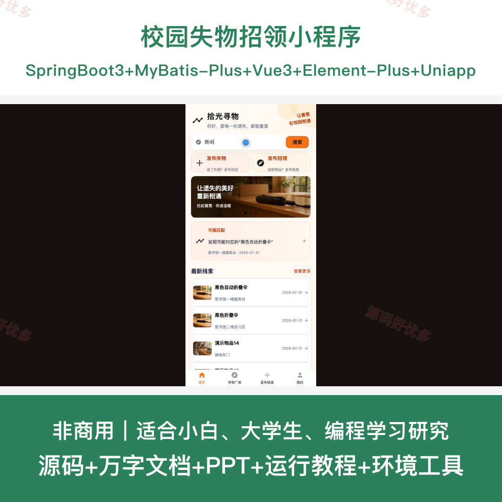
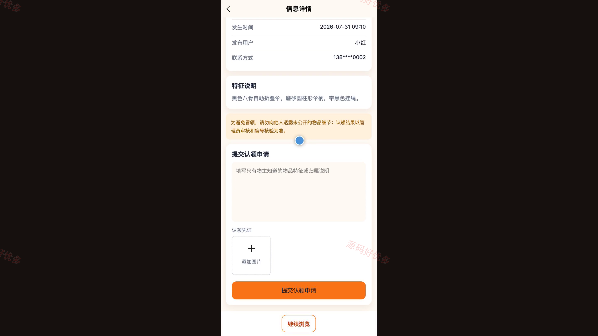
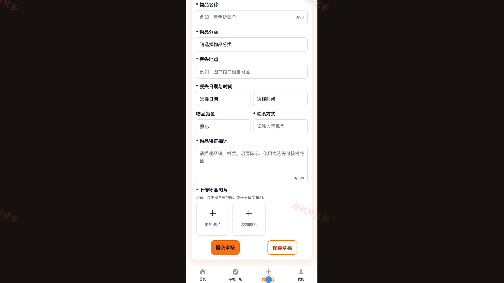
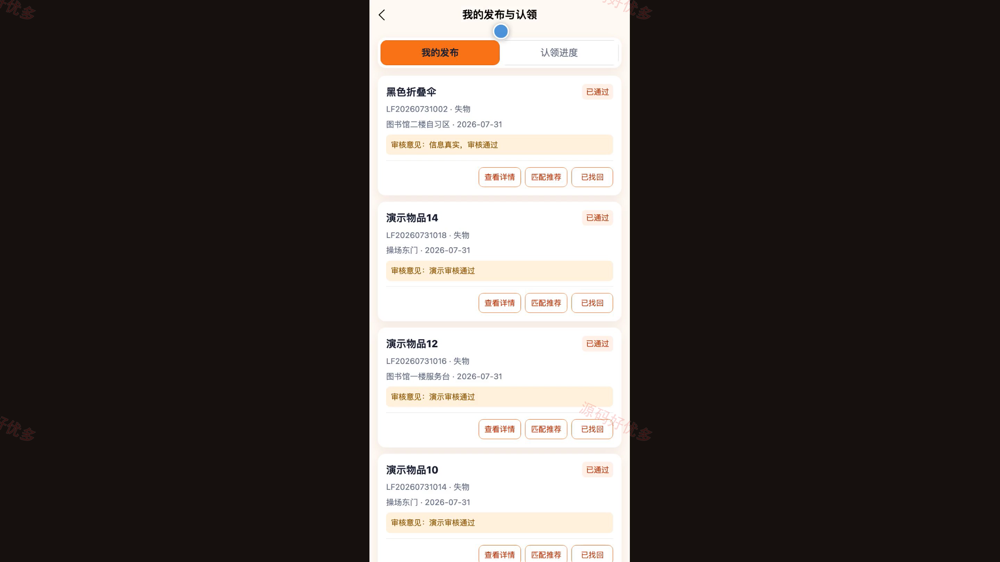
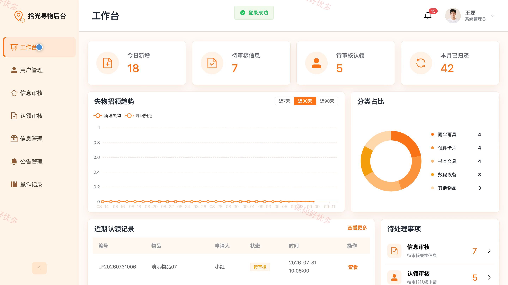
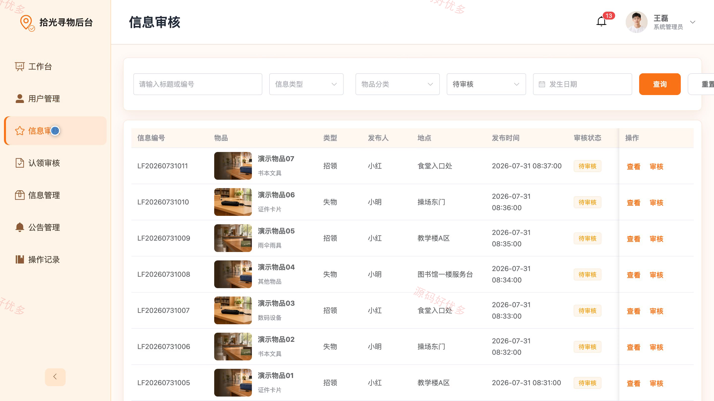
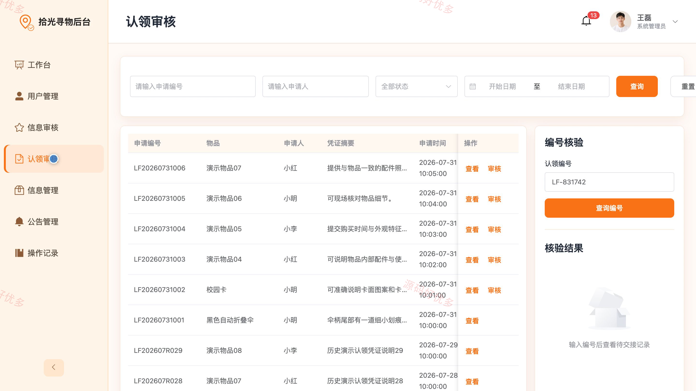

## 源码问题查看主页咨询

### 一、关键词
失物招领、寻物启事、物品认领、校园互助、遗失物品匹配

### 二、作品包含
源码+数据库+万字设计文档+PPT+全套环境和工具资源+本地部署教程

### 三、项目技术
前端技术： Html、Css、Js、Vue3.4、Element-Plus、uniapp
后端技术：Java、SpringBoot3.2.0、MyBatis-Plus

### 四、运行环境要求
开发工具：IDEA/eclipse + VSCODE + HBuilder X + 微信开发者工具

数据库：MySQL5.7+（共8张表）

数据库管理工具：Navicat10以上版本

环境配置软件： JDK17 + Maven3.6

前端Nodejs：20

浏览器：谷歌浏览器

### 五、项目介绍
项目编号：bs014B

校园失物招领小程序面向校园用户与管理人员，支持失物和招领信息发布、多条件检索、规则匹配推荐、认领申请及凭证审核，并通过唯一认领编号核验完成线下交接和归还闭环。

角色：用户、管理员

用户功能：账号登录与个人资料维护、失物招领信息检索、失物与招领信息发布、规则匹配推荐、认领申请与凭证提交、本人发布记录及状态更新、认领进度与编号查看、消息通知。

管理员功能：后台登录与数据看板、用户账号维护与停用、失物招领信息审核、认领申请审核、认领编号核验与归还确认、失物招领信息管理、公告管理、操作记录。

### 六、运行截图

